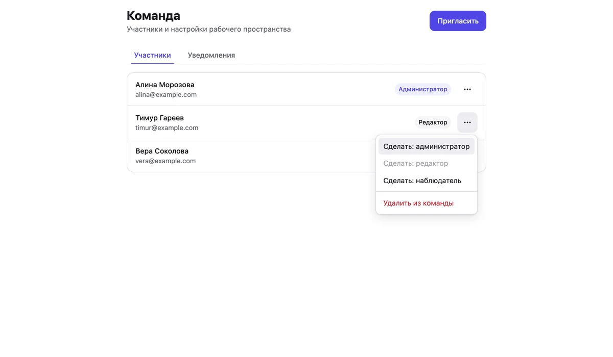
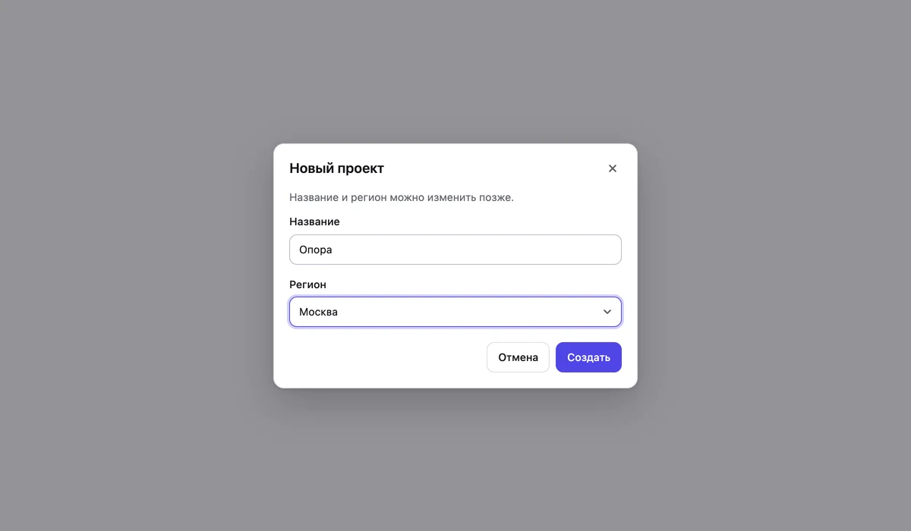
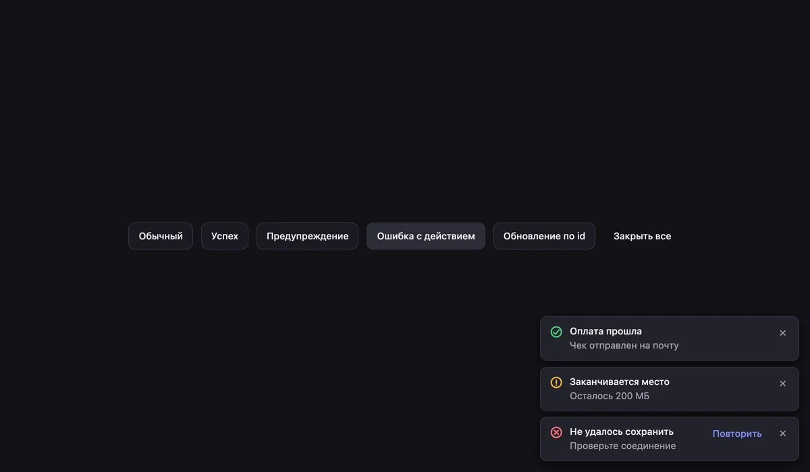

# Опора

Доступные React-компоненты, написанные с нуля — без Radix, Headless UI и других готовых
основ. Фокус, клавиатура, роли для скринридеров и позиционирование сделаны руками; в
исходниках каждого компонента написано, **почему** он устроен так.

**Демо (Storybook):** https://dmitriy9427.github.io/opora/ · **Учебник:** [docs/](docs/README.md)



| Диалог с ловушкой фокуса | Тосты, тёмная тема |
| --- | --- |
|  |  |

## Установка

```bash
npm install opora-ui
```

```tsx
import 'opora-ui/styles.css'
import { Button, Dialog, DialogContent, DialogTrigger, Field, Input, Toaster, toast } from 'opora-ui'

export function App() {
  return (
    <>
      <Dialog>
        <DialogTrigger asChild>
          <Button variant="primary">Новый проект</Button>
        </DialogTrigger>
        <DialogContent title="Новый проект" description="Название можно изменить позже.">
          <Field label="Название">
            <Input data-autofocus />
          </Field>
          <Button variant="primary" onClick={() => toast.success('Проект создан')}>
            Создать
          </Button>
        </DialogContent>
      </Dialog>
      <Toaster />
    </>
  )
}
```

Нужен React 19. Зависимостей, кроме React, нет.

## Компоненты

| Группа | Компоненты |
| --- | --- |
| Действия | `Button`, `Badge`, `Spinner` |
| Формы | `Field`, `Input`, `Textarea`, `Checkbox`, `Switch`, `RadioGroup`, `Select` |
| Структура | `Tabs`, `Accordion` |
| Всплывающие | `Dialog`, `Popover`, `Menu`, `Tooltip`, `toast` |
| Кирпичи | `Slot`, `Portal`, `VisuallyHidden`, `useControllableState`, `computePosition` |

## Что внутри

- **Доступность по WAI-ARIA.** Диалог с ловушкой фокуса и `inert` для остальной страницы;
  меню и вкладки с навигацией стрелками; селект на `aria-activedescendant` с поиском по
  первым буквам; тосты как «живые области» с таймером, который останавливается под курсором.
- **Нативные элементы под стилями.** Чекбокс, переключатель и радиокнопки — настоящие
  `<input>`: работают в формах без единой строки состояния.
- **Стопка слоёв.** Меню открыто из диалога: Escape закрывает меню, второй — диалог.
- **Своё позиционирование** с переворотом (flip), сдвигом (shift) и ограничением высоты.
- **Управляемый и неуправляемый режим** у всего, что имеет состояние; `asChild` для
  композиции; `ref` как обычный проп.
- **Стили не мешают.** Обычный CSS в каскадных слоях: любой стиль приложения сильнее
  библиотечного, без `!important`. Темы — CSS-переменные, светлая и тёмная.
- **21,8 КБ** JavaScript и **7,5 КБ** CSS (gzip) за всю библиотеку; неиспользуемое выбрасывается.

## Своя тема

```css
:root {
  --op-accent: #0a8f5b;
  --op-radius: 4px;
}
```

```html
<html data-theme="dark">
```

## Разработка

```bash
npm install
npm run dev      # Storybook на http://localhost:6010
```

| Команда | Что делает |
| --- | --- |
| `npm test` | 133 теста: поведение, клавиатура, доступность (axe) |
| `npm run build` | пакет в `dist/`: ES-модули, типы, один CSS |
| `npm run check:package` | `publint` и `attw`: всё ли в порядке с `package.json` и типами |
| `npm run test:package` | упаковать и «установить» во временное приложение: типы, Node, SSR |
| `npm run check` | всё подряд, включая бюджет размера |

## Учебник

[С чего начать](docs/README.md) · [Как устроен npm-пакет](docs/02-package.md) ·
[Стили и слои](docs/03-styles.md) · [API компонентов](docs/04-api-design.md) ·
[Доступность](docs/05-accessibility.md) · [Всплывающие слои](docs/06-overlays.md) ·
[Найденные баги](docs/lessons.md) · [Вопросы к собеседованию](docs/interview.md)

## Лицензия

MIT
