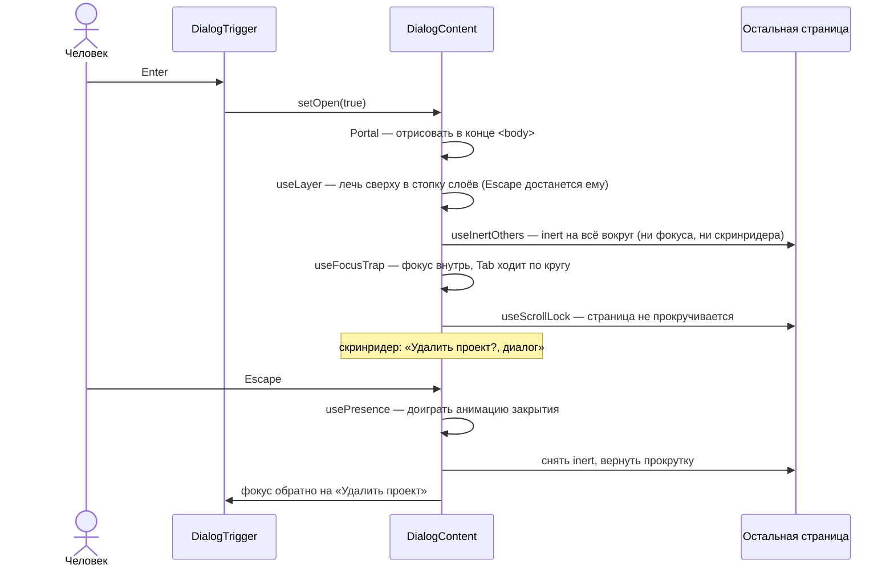

# 00. С чего начать

Этот учебник для человека, который знает React (компоненты, пропсы, `useState`, `useEffect`),
но ещё не писал **библиотек** компонентов и не задумывался, как кнопкой пользуется человек без
мыши или со скринридером.

Если вы хотите просто поставить «Опору» в проект — вам в [руководство](usage.md). Здесь — как
она устроена внутри.

## Как устроена каждая глава

1. **Зачем** — какую боль решает эта часть, на бытовом примере.
2. **Самый маленький пример** — несколько строк, которые можно понять целиком.
3. **Как это сделано в «Опоре»** — настоящий код с разбором.
4. **Ошибки** — что ломается у всех в первый раз.
5. **Попробуйте сами** — задания с ответами под спойлером.

Читайте с запущенным Storybook (`npm run dev`) и проходите каждый компонент **без мыши**: Tab,
стрелки, Enter, Пробел, Escape.

## Картинка целиком: что происходит, когда открывают диалог

Человек нажимает «Удалить проект» — открывается окно подтверждения. Снаружи это одно
действие. Внутри — семь:

Для зрячего человека с мышью из всего этого заметно только затемнение. Для всех остальных —
без любого из шагов окно сломано: Tab уводит «под» окно, скринридер читает страницу за ним,
после закрытия фокус теряется на `<body>`.

Каждый шаг — отдельный маленький **примитив** в `src/primitives/`. Компоненты собираются из
них, как из кубиков.

## Словарь в одну строку

| Слово | Простыми словами | Пример в проекте |
| --- | --- | --- |
| **Доступность (a11y)** | Интерфейсом могут пользоваться все: без мыши, без зрения, с увеличением | весь проект |
| **Скринридер** | Программа, которая читает интерфейс вслух и управляется клавиатурой | VoiceOver (`Cmd + F5` на Mac) |
| **Роль** | Что это за элемент для скринридера | `role="dialog"`, `role="menuitem"` |
| **Доступное имя** | Как элемент называется для скринридера | текст кнопки, `aria-label`, `aria-labelledby` |
| **Состояние** | Что с элементом сейчас | `aria-expanded`, `aria-selected`, `aria-checked` |
| **ARIA** | Атрибуты, которые сообщают скринридеру роль, имя и состояние | `aria-*`, `role` |
| **Фокус** | «Курсор» клавиатуры: какой элемент получит Enter | `element.focus()` |
| **Ловушка фокуса** | Tab не выходит за пределы окна | `useFocusTrap` |
| **`inert`** | Атрибут «этой части страницы как будто нет» | `useInertOthers` |
| **Блуждающий tabindex** | В группе Tab попадает только на текущий элемент, остальные — стрелками | `Tabs` |
| **`aria-activedescendant`** | Фокус остаётся на кнопке, а «текущий» пункт списка указан атрибутом | `Select` |
| **Портал** | Отрисовать элемент в конце `<body>`, оставив его на месте в дереве React | `Portal` |
| **Слой** | Всё, что открыто поверх страницы: диалог, меню, поповер | `useLayer` |
| **Управляемый режим** | Значением владеет родитель: `value` + `onValueChange` | `<Tabs value={tab}>` |
| **Неуправляемый режим** | Компонент хранит значение сам: `defaultValue` | `<Tabs defaultValue="a">` |
| **Составной компонент** | Один компонент из нескольких частей, связанных контекстом | `<Dialog><DialogTrigger/><DialogContent/></Dialog>` |
| **`asChild`** | Отдать своё поведение чужому элементу вместо своего тега | `<Button asChild><a href>…</a></Button>` |
| **Токен** | Именованное значение дизайна в CSS-переменной | `--op-accent` |
| **Каскадный слой** | `@layer` — порядок, в котором применяются стили | стили библиотеки не перебивают ваши |
| **peerDependency** | Зависимость, которую библиотека берёт из проекта, а не ставит сама | `react` |
| **SemVer** | Номер версии `мажор.минор.патч` — обещание о совместимости | `0.1.0` |

## Как читать код проекта

- **Комментарий в начале каждого файла** объясняет «зачем» и «почему так» — часто там же
  клавиатура и роли компонента по шаблону WAI-ARIA.
- **Тест рядом** (`*.test.tsx`) — список требований: прочитайте только строки `it(…)`.
- **Порядок чтения** — от простого к сложному: `compose.ts` → `slot.tsx` → `button` → `field` →
  `checkbox` → `tabs` → `layers.ts` → `focus.ts` → `dialog` → `position.ts` → `menu` → `select` → `toast`.

## Порядок чтения учебника

| Если вы хотите… | Читайте |
| --- | --- |
| осмотреться и запустить | [01. Обзор](01-overview.md) |
| понять, чем пакет отличается от приложения | [02. Пакет](02-package.md) |
| стили, которые легко переопределить | [03. Стили](03-styles.md) |
| удобный API компонентов | [04. API](04-api-design.md) |
| доступность с нуля | [05. Доступность](05-accessibility.md) |
| диалоги, меню, поповеры | [06. Всплывающие слои](06-overlays.md) |
| понять конкретный компонент | [Разбор кода](code/README.md) — файл за файлом, и [07. Разбор компонентов](07-components.md) |
| тесты и публикацию | [08](08-testing.md), [09](09-publishing.md) |

Если времени мало — **04 → 05 → 06** и разбор диалога. Это сердце проекта.
