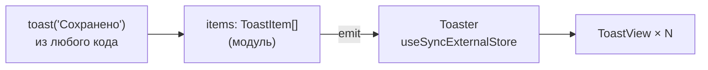

# 7. Тосты

[src/components/toast/toast.tsx](../../src/components/toast/toast.tsx)

## Где это

Внизу справа: «Сохранено», «Не удалось сохранить — Нет связи [Повторить]». Исчезают сами через
5 секунд (с кнопкой действия — через 8).

## Что делает

- Показывается **функцией** из любого места: обработчика, запроса, хранилища.
- Не больше четырёх одновременно: лишние старые закрываются.
- Повторный вызов с тем же `id` обновляет тост, а не создаёт второй («Сохраняю…» → «Сохранено»).
- Скринридер читает: обычные — вежливо (`status`), ошибки — сразу (`alert`).
- Таймер **на паузе**, пока на тостах курсор или фокус и пока вкладка скрыта.
- Доигрывает анимацию закрытия.

## Пример

```tsx
// один раз в приложении
<Toaster position="bottom-right" />

// где угодно
toast('Сохранено')
toast.error('Не удалось сохранить', { description: 'Нет связи', action: { label: 'Повторить', onClick: save } })
const id = toast('Загружаю…', { duration: Infinity })
toast.success('Загружено', { id })    // тот же тост сменил текст
```

## Почему функция, а не компонент

Сообщение нужно показать **из обработчика или запроса** — там нет компонента, в который можно
вставить `<Toast>`. Поэтому список тостов живёт в обычном модуле (массив + подписчики), а
`<Toaster />` только читает его.



## Код по частям

### Хранилище

```ts
let items: ToastItem[] = []
const listeners = new Set<() => void>()
const emit = () => listeners.forEach((listener) => listener())
const set = (next: ToastItem[]) => { items = next; emit() }
```

Каждый `set` — **новый массив**. `useSyncExternalStore` сравнивает снимки по ссылке: новый массив
— перерисовать, тот же — нет.

### `show`

```ts
function show(title, options = {}) {
  const id = options.id ?? `toast-${++counter}`
  const item = { ...options, id, title, type: options.type ?? 'info',
    duration: options.duration ?? (options.action ? 8000 : 5000), closing: false }
  const exists = items.some((existing) => existing.id === id)
  const next = exists ? items.map((existing) => (existing.id === id ? item : existing)) : [...items, item]
  set(next)
  next.filter((existing) => !existing.closing).slice(0, -LIMIT).forEach((old) => dismiss(old.id))
  return id
}
```

- С кнопкой действия — дольше (8 с): нужно успеть прочитать **и** решить.
- Тот же `id` — замена на месте, без второго тоста.
- `slice(0, -LIMIT)` — все, кроме последних четырёх живых, закрываются.

### `dismiss` — в два шага

```ts
function dismiss(id?: string) {
  const targets = items.filter((item) => (id ? item.id === id : true) && !item.closing).map((item) => item.id)
  if (!targets.length) return
  set(items.map((item) => (targets.includes(item.id) ? { ...item, closing: true } : item)))
  setTimeout(() => set(items.filter((item) => !targets.includes(item.id))), EXIT_MS)
}
```

1. Пометить `closing` → `data-state="closed"` → CSS играет анимацию ухода.
2. Через 180 мс — удалить из списка.

Без аргумента закрывает все.

### `toast` — функция с методами

```ts
export const toast = Object.assign(show, {
  success: (title, options) => show(title, { ...options, type: 'success' }),
  error: …, warning: …, dismiss,
})
```

Функция в JS — объект: ей можно добавить свойства. `toast('…')` и `toast.error('…')` — одна
сущность.

### `Toaster`

```tsx
export function Toaster({ position = 'bottom-right', label = 'Уведомления' }) {
  const list = useSyncExternalStore(subscribe, getSnapshot, () => EMPTY)
  const paused = useRef(false)
  return (
    <Portal>
      <section aria-label={label} className="op-toaster" data-position={position} data-op-keep=""
        onPointerEnter={() => (paused.current = true)} onPointerLeave={() => (paused.current = false)}
        onFocus={() => (paused.current = true)} onBlur={() => (paused.current = false)}>
        {list.map((item) => <ToastView key={item.id} item={item} paused={paused} />)}
      </section>
    </Portal>
  )
}
```

- Область существует **всегда**, даже пустая: скринридер должен знать «живую область» **до**
  появления в ней текста — иначе первый тост может не зачитаться.
- `data-op-keep` — открытый диалог не делает тосты недоступными.
- `paused` — `ref`, а не состояние: пауза не должна перерисовывать тосты, её читают таймеры.
- `() => EMPTY` — снимок для сервера: на сервере тостов нет.

### Таймер с паузой

```tsx
useEffect(() => {
  if (!Number.isFinite(item.duration) || item.closing) return
  let left = item.duration
  let last = Date.now()
  const timer = setInterval(() => {
    const now = Date.now()
    if (!paused.current && !document.hidden) left -= now - last
    last = now
    if (left <= 0) dismiss(item.id)
  }, 100)
  return () => clearInterval(timer)
}, [item.id, item.duration, item.closing, paused])
```

Не `setTimeout(dismiss, 5000)`, а «счётчик оставшегося времени»: каждые 100 мс вычитаем
прошедшее, **если не пауза**. Навели курсор на 3 секунды — оставшееся время сохранилось, а не
началось заново. Ушли на другую вкладку — время не идёт: вернувшись, человек увидит тост. Это
требование WCAG 2.2.1 «достаточно времени».

`Infinity` — только ручное закрытие.

### Роли

```tsx
<div role={item.type === 'error' ? 'alert' : 'status'} …>
```

`status` — скринридер дождётся паузы в речи. `alert` — прервёт и прочитает сразу: ошибку нельзя
пропустить.

## Что будет, если…

| Сделать | Что сломается |
| --- | --- |
| рендерить `<section>` только при наличии тостов | первый тост скринридер может пропустить |
| `setTimeout` вместо счётчика | пока человек читал с наведённым курсором, тост исчез |
| мутировать `items.push(...)` | `useSyncExternalStore` не увидит изменения (та же ссылка) |
| без `data-op-keep` | при открытом диалоге уведомление недоступно |

## Проверьте себя

1. Почему `paused` хранится в `ref`, а не в `useState`?
2. Как показать «Сохраняю…» и затем заменить его на «Сохранено» тем же тостом?
3. Важное действие («Отменить удаление») только в тосте — почему это плохо?

<details>
<summary>Ответы</summary>

1. Пауза не меняет вид — её читает таймер. Состояние вызывало бы лишние перерисовки при каждом
   движении курсора.
2. `const id = toast('Сохраняю…', { duration: Infinity })`, затем `toast.success('Сохранено', { id })`.
3. Тост исчезнет — человек с медленным чтением или со скринридером может не успеть. Действие
   должно быть доступно и в интерфейсе.
</details>
